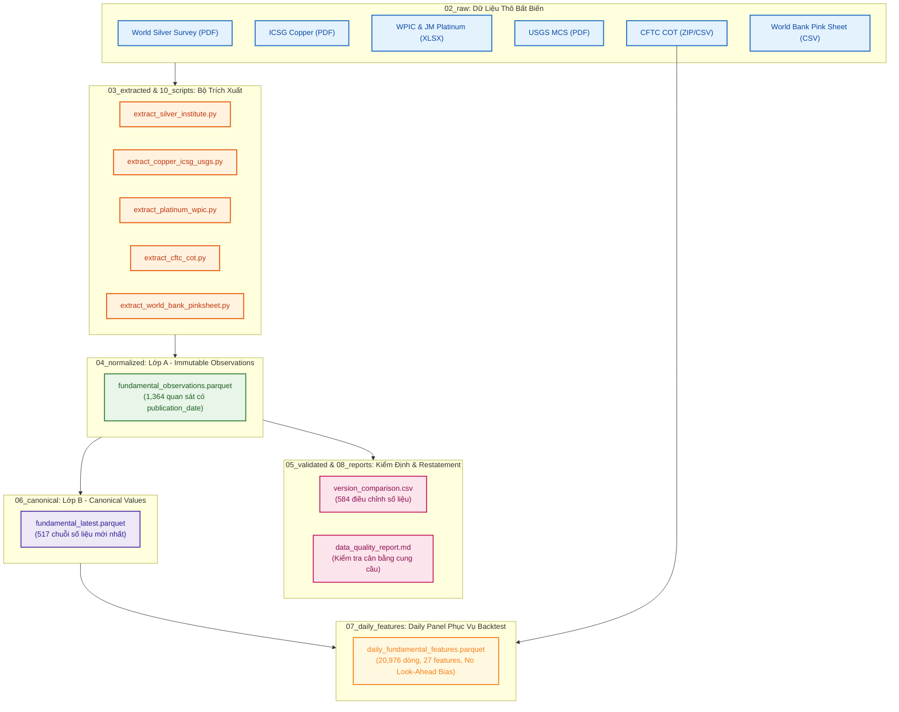

# 🏭 Commodity Equilibrium Historical Data Engine
### Silver (Bạc) | Copper (Đồng) | Platinum (Bạch kim)

Hệ thống dữ liệu lịch sử cân bằng cung cầu hàng hóa chuyên biệt phục vụ phân tích cân bằng vật chất toàn cầu, phát hiện trạng thái Surplus/Deficit, theo dõi vị thế CFTC COT, biến động tồn kho và tạo daily fundamental features không look-ahead bias cho quantitative research và backtesting.

---

## 🏛️ Kiến Trúc Thư Mục Hệ Thống
```
commodity_equilibrium/
├── 00_config/                 # Cấu hình dự án, tham số chuyển đổi đơn vị, balance formula
│   └── config.json
├── 01_source_registry/        # Đăng ký nguồn, danh mục chỉ tiêu, manifest kiểm tra mã băm
│   ├── source_registry.csv    # 14 nguồn dữ liệu chính thức đã kiểm định
│   ├── data_dictionary.csv    # 25 chỉ tiêu cung cầu chuẩn hóa
│   └── download_manifest.csv  # Danh sách file raw bất biến kèm SHA256 checksum
├── 02_raw/                    # Dữ liệu raw gốc bất biến (Immutable Raw Storage)
│   ├── silver/                # 7 bản báo cáo World Silver Survey (2015-2024)
│   ├── copper/                # Báo cáo ICSG Table 1, Table 2, Chart 1, 2026 Forecast
│   ├── platinum/              # File WPIC Excel quarterly (4MB) & Johnson Matthey (1975-2012)
│   ├── usgs/                  # 18 bản báo cáo USGS Mineral Commodity Summaries (2020-2025)
│   ├── cftc_cot/              # 14 tệp zip CFTC COT Disaggregated & Legacy (2018-2024)
│   ├── world_bank/            # World Bank Pink Sheet Monthly 1960-2026
│   └── macro_cross/           # Daily continuous futures (SI, HG, PL, GC, CL), ETFs, DXY, FRED
├── 03_extracted/              # Dữ liệu trích xuất từ PDF, Excel, ZIP sang CSV phẳng
├── 04_normalized/             # Lớp A: Immutable Observations (1,364 quan sát)
│   ├── fundamental_observations.csv
│   └── fundamental_observations.parquet
├── 05_validated/              # Kết quả kiểm định chất lượng & bảng theo dõi điều chỉnh số liệu (Restatements)
│   ├── version_comparison.csv # 584 điều chỉnh lịch sử giữa các phiên bản báo cáo
│   └── data_quality_issues.csv
├── 06_canonical/              # Lớp B: Latest Canonical Values (517 chuỗi chuẩn)
│   ├── fundamental_latest.csv
│   └── fundamental_latest.parquet
├── 07_daily_features/         # Daily Panel cho Quantitative Research & Backtest (20,976 dòng)
│   ├── daily_fundamental_features.csv
│   └── daily_fundamental_features.parquet
├── 08_reports/                # Báo cáo tổng kết, bảng cân bằng cung cầu, ma trận độ phủ
│   ├── data_quality_report.md
│   ├── coverage_matrix.md
│   ├── final_commodity_equilibrium_report.md
│   └── pdf_extraction_methodology.md # Hướng dẫn kỹ thuật bóc tách PDF chi tiết
└── 10_scripts/                # Pipeline script tái thực thi tự động (Resumable & Idempotent)
    ├── 00_init_environment.py
    ├── 01_source_discovery_probe.py
    ├── 02_build_source_registry.py
    ├── 03_download_wpic_platinum.py
    ├── 04_download_world_bank_pinksheet.py
    ├── 05_download_silver_institute.py
    ├── 06_download_icsg_copper.py
    ├── 07_download_usgs_mcs.py
    ├── 08_download_cftc_cot.py
    ├── 09_download_futures_macro.py
    ├── 10_extract_platinum_wpic.py
    ├── 11_extract_silver_institute.py
    ├── 12_extract_cftc_cot.py
    ├── 13_extract_world_bank_pinksheet.py
    ├── 14_extract_copper_icsg_usgs.py
    ├── 15_build_canonical_and_versioning.py
    ├── 16_data_quality_audit.py
    ├── 17_build_daily_features.py
    └── 18_generate_coverage_matrix_and_readme.py
```

---

## 📊 Sơ Đồ Luồng Xử Lý Dữ Liệu (Mermaid Architecture)



---

## 🚀 Hướng Dẫn Tái Chạy & Cập Nhật Dữ Liệu (Runbook)

### 1. Yêu Cầu Môi Trường
- Python >= 3.10
- Thư viện cần thiết: `pandas`, `requests`, `openpyxl`, `pyarrow`, `pdfplumber`, `yfinance`, `beautifulsoup4`, `duckdb`

### 2. Lệnh Chạy Toàn Bộ Pipeline
Để chạy lại toàn bộ quy trình từ tải file, trích xuất, đối soát đến tạo daily features:
```powershell
cd "e:\My\the20\test_strategy\commodity source\commodity_equilibrium"

# 1. Khởi tạo môi trường
python 10_scripts/00_init_environment.py

# 2. Xây dựng Source Registry và Data Dictionary
python 10_scripts/02_build_source_registry.py

# 3. Tải dữ liệu thô (Bulk Downloaders - Bất biến & Resumable)
python 10_scripts/03_download_wpic_platinum.py
python 10_scripts/04_download_world_bank_pinksheet.py
python 10_scripts/05_download_silver_institute.py
python 10_scripts/06_download_icsg_copper.py
python 10_scripts/07_download_usgs_mcs.py
python 10_scripts/08_download_cftc_cot.py
python 10_scripts/09_download_futures_macro.py

# 4. Trích xuất & Chuẩn hóa dữ liệu thô
python 10_scripts/10_extract_platinum_wpic.py
python 10_scripts/11_extract_silver_institute.py
python 10_scripts/12_extract_cftc_cot.py
python 10_scripts/13_extract_world_bank_pinksheet.py
python 10_scripts/14_extract_copper_icsg_usgs.py

# 5. Xây dựng Lớp A (Observations), Lớp B (Canonical) và Bảng Restatement
python 10_scripts/15_build_canonical_and_versioning.py

# 6. Kiểm định chất lượng & Đối chiếu Cân bằng Cung Cầu
python 10_scripts/16_data_quality_audit.py

# 7. Xây dựng Daily Fundamental Features (No Look-Ahead Bias)
python 10_scripts/17_build_daily_features.py

# 8. Cập nhật Báo cáo & Coverage Matrix
python 10_scripts/18_generate_coverage_matrix_and_readme.py
```

---

## 📐 Nguyên Tắc Tránh Look-Ahead Bias Trong Nghiên Cứu Lượng Hóa
1. **Dữ liệu Fundamental (Cung - Cầu - Cân bằng)**:
   - Sử dụng trường `available_at` (thời điểm báo cáo được phát hành thực tế tới thị trường), tuyệt đối không dùng `period_end`.
   - Forward-fill giá trị cung cầu chỉ xuất hiện từ sau ngày công bố báo cáo.
2. **Dữ liệu Vị thế (CFTC Commitments of Traders)**:
   - Dữ liệu vị thế chốt vào thứ Ba hàng tuần nhưng chỉ được CFTC công bố vào 15:30 EST thứ Sáu.
   - Hệ thống tự động gán ngày hiệu lực giao dịch `available_date = report_date + 3 ngày` (thứ Sáu) để tránh đưa dữ liệu chưa công bố vào backtest giữa tuần.
3. **Theo Dõi Revisions (Restatement)**:
   - Mọi bản sửa đổi lịch sử đều được lưu độc lập tại Layer A kèm `source_edition` và `publication_date`, không ghi đè số liệu cũ.
